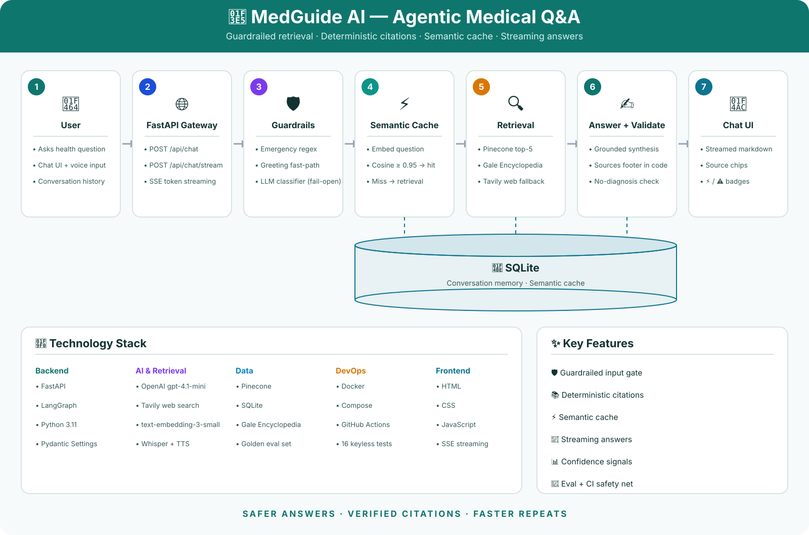
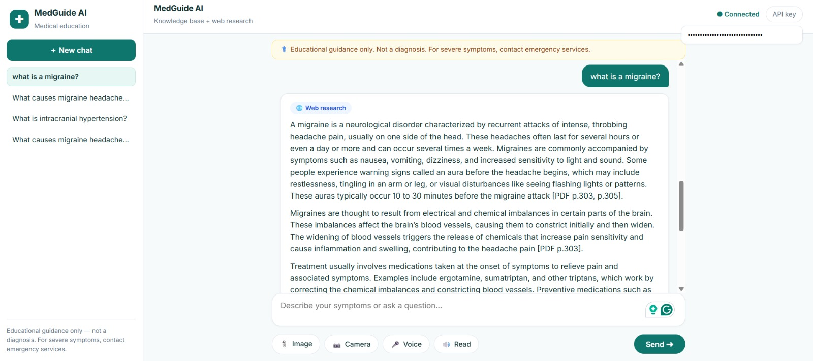
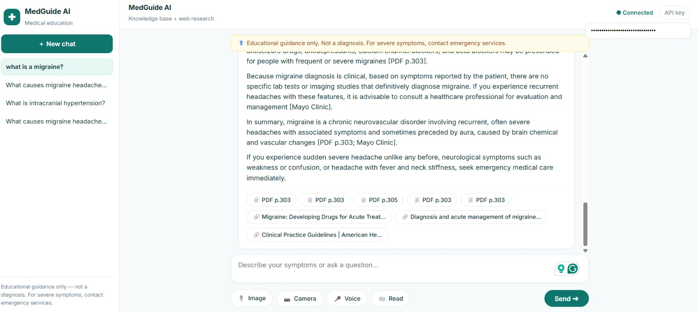
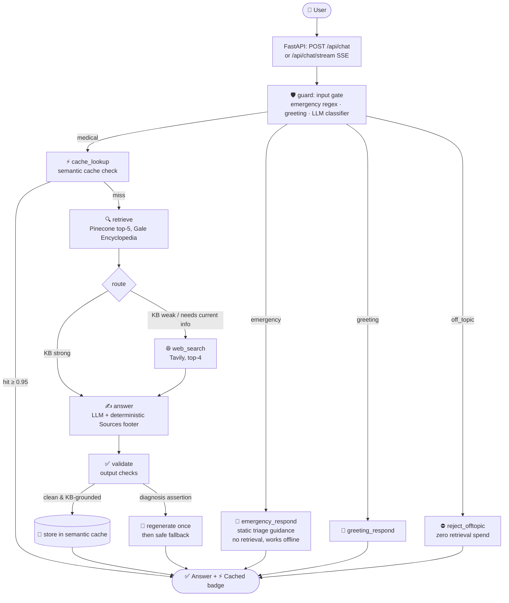
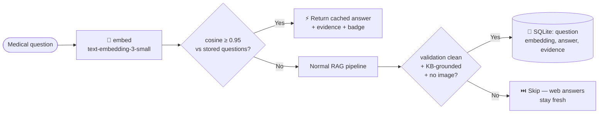
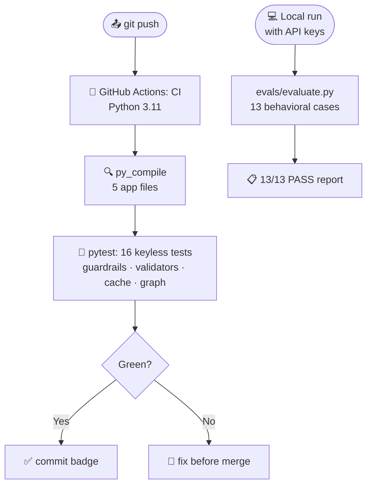

# 🏥 MedGuide AI

###### Agentic medical Q&A with safety guardrails, deterministic citations & streaming — FastAPI · LangGraph · Pinecone · Tavily

[](https://github.com/zainsardar0/MedGuide-AI/actions/workflows/ci.yml)


**MedGuide AI** is a production-oriented **agentic medical assistant** that answers health-education questions with grounded, cited, safety-checked responses.

Unlike a typical RAG demo that pipes a prompt straight into an LLM, MedGuide AI runs every question through an **autonomous LangGraph agent** with pre-retrieval safety guardrails, a semantic cache for repeat questions, deterministic citation handling, and an output validator that refuses to assert diagnoses. Safety checks run *before* any retrieval spend — and citations are appended in code from the evidence actually retrieved, never trusted to the model.



---

## Why MedGuide AI?

A general-purpose chatbot answering medical questions is a liability: it can assert a confident diagnosis, invent citations, or answer an emergency with a paragraph of text. Each of those failures can cause real harm.

MedGuide AI is built around the opposite priorities:

- **Triage before trivia** — emergency phrasing is detected deterministically and answered with immediate-care guidance, no retrieval, no waiting on the model.
- **Citations you can verify** — every factual claim carries an inline `[PDF p.N]` citation, and a **Sources** section is appended deterministically in code from the retrieved evidence. The model is explicitly forbidden from writing its own.
- **Refuse what isn't medical** — off-topic questions are declined without spending a cent on retrieval or generation.
- **Honest about uncertainty** — when evidence is weak, the UI says so instead of bluffing.

## Key Features

| Capability | Description |
| --- | --- |
| 🛡️ Guardrail input gate | Deterministic emergency/greeting detection plus an LLM medical-vs-off-topic classifier that **fails open** — a medical question is never refused by mistake. |
| ⚡ Semantic cache | Repeat questions are embedded and matched against past answers (cosine ≥ 0.95); hits skip Pinecone, Tavily, and the LLM entirely. Only clean, KB-grounded, non-image answers are cached, with a 30-day TTL. |
| 📚 Deterministic citations | Inline `[PDF p.N]` citations plus a **Sources** footer built in code from the retrieved pages and URLs. |
| 🔍 Hybrid retrieval | Pinecone vector search over the *Gale Encyclopedia of Medicine* (2002), with Tavily web fallback when the KB is weak or the question needs current guidance. |
| ✅ Output validator | Flags missing citations and diagnosis assertions; regenerates once, then falls back to a safe response. |
| 🚨 Emergency fast-path | Static triage guidance served instantly — works even if the LLM is down. |
| 📡 Streaming answers | Token-by-token SSE streaming with clickable source chips and PDF excerpt previews. |
| 📊 Confidence signals | API exposes `kb_top_score`, `route`, and `low_confidence`; the UI shows an honest "Limited evidence" badge when grounding is weak. |
| 🧪 Two-tier testing | 16 keyless pytest checks run in CI on every push; a 13-case behavioral eval suite runs locally with real keys. |
| 🐳 Dockerized | Pinned Python 3.11 image plus one-command `docker compose` deploy with persistent conversation memory. |

---

## Screenshots

> Add your screenshots to `docs/screenshots/` — they will render here.

| Chat | Sources & confidence |
| --- | --- |
|  |  |

---

## 🏛️ System Architecture

### 1. End-to-End Query Lifecycle

Every question flows through the LangGraph agent below. Guardrail fast-paths (emergency / greeting / off-topic) exit immediately; medical questions try the semantic cache before any retrieval spend.



### 2. Semantic Cache Flow (Step 10)



### 3. Evaluation & CI Pipeline



---

## ⚡ Key Engineering Decisions & Trade-Offs

| Decision | What Was Built | Why It Matters |
| --- | --- | --- |
| **Pre-retrieval guardrails** | Deterministic emergency/greeting matchers + LLM medical-vs-off-topic classifier | Blocks off-topic and jailbreak-style questions *before* any Pinecone/LLM spend; the classifier **fails open** so a medical question is never wrongly refused. |
| **Deterministic citations** | The **Sources** footer is appended in code from retrieved evidence; the system prompt forbids the model from writing its own | Model-written citations hallucinate. Code-appended ones cannot silently go missing — the eval suite enforces this. |
| **Fail-open safety design** | Every external call (LLM, Pinecone, Tavily, embeddings) is wrapped; static degraded fallbacks exist | An emergency answer must never fail because an API is down. Degraded is always better than silent. |
| **No-diagnosis output validator** | Flags `diagnosis_assertion` / `missing_citations`; regenerates once, then serves a safe fallback | Catches the single most dangerous failure mode of a medical bot — asserting a diagnosis — even if the model slips. |
| **Conservative semantic cache** | Cosine ≥ 0.95, KB-grounded answers only, never image questions, 30-day TTL | Repeat questions answer almost instantly with zero API cost, without the risk of serving a merely-similar answer to a different medical question. |
| **SQLite for state** | Conversation checkpointer + semantic cache in SQLite, paths configurable via env | Zero infrastructure to operate; Docker named volume persists both across restarts. |
| **Keyless CI** | 16 deterministic pytest checks with empty API keys on every push | Every commit is verified without secrets or spend; the keyed behavioral eval stays local where the keys live. |
| **Python 3.11 pinned everywhere** | Dockerfile, CI runner, and dev venv all on 3.11 | Eliminated an entire class of "works on my machine" bugs — including a real f-string syntax failure caught the hard way. |

---

## Application Workflow

What happens when a user asks *"What is Bell's palsy?"*:

1. **Request arrives** — `POST /api/chat/stream` with the message and conversation ID.
2. **Input gate** — `guard` classifies intent. Not an emergency, not a greeting, classifier says `medical`.
3. **Cache check** — `cache_lookup` embeds the question; no past question is ≥ 0.95 similar → miss.
4. **Retrieval** — `retrieve` queries Pinecone (top-5, min score 0.30) against the Gale Encyclopedia of Medicine.
5. **Routing** — `route`: top KB score is strong and the question isn't time-sensitive → `answer` (no web search).
6. **Generation** — `answer` builds the prompt (system rules + history + excerpts) and streams tokens; the **Sources** footer is appended in code.
7. **Validation** — `validate`: citations present, no diagnosis assertion → clean. The answer is stored in the semantic cache.
8. **Response** — the UI renders streamed markdown, source chips, and the 📚 Knowledge base badge.
9. **Repeat** — asking *"tell me about Bell's palsy"* tomorrow hits the cache: instant answer, ⚡ badge, zero API cost.

---

## 🛠️ Technology Stack

| Technology | Purpose | Reason for Selection |
| --- | --- | --- |
| Python 3.11 | Core language | Pinned across venv, CI, and Docker for reproducibility. |
| FastAPI | REST API + SSE streaming | Async-native, automatic validation, first-class `StreamingResponse`. |
| LangGraph | Agent orchestration | Cyclic state machine fits guard → retrieve → validate flow better than a linear chain. |
| Pinecone | Vector database | Managed, serverless; cosine search over the medical encyclopedia index. |
| Tavily | Web fallback search | Purpose-built for LLM/RAG grounding when the KB is weak or dated. |
| OpenAI | Chat, embeddings, vision, TTS/STT | `gpt-4.1-mini` for chat/vision, `text-embedding-3-small` for retrieval + cache. |
| SQLite | Conversation memory + semantic cache | Zero-ops persistence; survives restarts via Docker volume. |
| Docker / Compose | Containerization | One-command reproducible deploy; secrets injected at runtime, never baked in. |
| GitHub Actions | CI | Keyless test suite on every push. |
| Vanilla JS + CSS | Frontend | No build step; markdown-lite renderer with XSS escaping. |

---

## 📂 Project Structure

```
MedGuide-AI/
├── app/
│   ├── agent.py             # LangGraph definition: guard → cache_lookup → retrieve → route → web/answer → validate
│   ├── guardrails.py        # Input gate (emergency/greeting/classifier) + output validators
│   ├── knowledge.py         # Pinecone retrieval + OpenAI embeddings
│   ├── semantic_cache.py    # SQLite semantic cache (embed → cosine ≥ 0.95 → instant answer)
│   ├── config.py            # pydantic-settings: thresholds, models, cache tuning, all from .env
│   └── main.py              # FastAPI app: /api/chat, /api/chat/stream (SSE), transcribe, speak
├── evals/
│   ├── evaluate.py          # 13-case behavioral eval (runs locally with real keys)
│   └── golden.json          # Golden questions: KB, web, emergency, guardrail cases
├── tests/
│   └── test_smoke.py        # 16 keyless pytest checks (run in CI)
├── static/
│   ├── app.js               # Chat UI: streaming, source chips, badges, history
│   └── style.css            # "Clinical Teal" theme
├── templates/
│   └── index.html           # Single-page chat app
├── data/
│   └── Medical_book.pdf     # Gale Encyclopedia of Medicine (ingested to Pinecone)
├── ingest.py                # PDF → chunks → Pinecone indexing script
├── Dockerfile               # Python 3.11-slim production image
├── docker-compose.yml       # One-command deploy; medmem volume persists memory + cache
├── .dockerignore            # Keeps .env and local DBs out of the image
├── .github/workflows/ci.yml # Compile check + keyless pytest on every push
├── .env.example             # Template for required environment variables
└── requirements.txt         # Pinned Python dependencies
```

---

## 🚀 Quickstart

### 1. Prerequisites

- **Python 3.11**, **Git**
- **Docker** (optional, for containerized run)
- API keys: **OpenAI**, **Pinecone**, **Tavily** (for web fallback)

### 2. Local run

```bash
git clone https://github.com/zainsardar0/MedGuide-AI.git
cd MedGuide-AI

python -m venv .venv
# Windows (PowerShell):
.\.venv\Scripts\Activate.ps1
# macOS/Linux:
# source .venv/bin/activate

pip install -r requirements.txt

cp .env.example .env   # then fill in your keys
# (Optional) index the knowledge base:
python ingest.py

uvicorn app.main:app --reload
```

Open http://127.0.0.1:8000 🎉

### 3. Docker run

```bash
cp .env.example .env   # fill in your keys (never committed)
docker compose up --build
```

The API is at http://localhost:8000. Conversation memory and the semantic cache persist in the `medmem` volume across restarts.

---

## 🔑 Environment Variables

| Variable | Required | Default | Purpose |
| --- | --- | --- | --- |
| `OPENAI_API_KEY` | ✅ | — | Chat, embeddings, vision, transcription |
| `PINECONE_API_KEY` | ✅ | — | Vector search over the medical encyclopedia |
| `TAVILY_API_KEY` | ❌ | — | Web fallback; retrieval is KB-only without it |
| `API_TOKEN` | ❌ | — | Bearer token auth; mandatory when `APP_ENV=production` |
| `APP_ENV` | ❌ | `development` | Set to `production` to enforce `API_TOKEN` |
| `PINECONE_INDEX` | ❌ | `medical-agent-demo` | Pinecone index name |
| `KB_TOP_K` | ❌ | `5` | Chunks retrieved per question |
| `KB_MIN_SCORE` | ❌ | `0.30` | Minimum Pinecone score to keep a chunk |
| `WEB_FALLBACK_SCORE` | ❌ | `0.62` | Below this top KB score → Tavily web search |
| `SEMANTIC_CACHE_ENABLED` | ❌ | `true` | Toggle the repeat-question cache |
| `SEMANTIC_CACHE_THRESHOLD` | ❌ | `0.95` | Cosine similarity required for a cache hit |
| `SEMANTIC_CACHE_TTL_DAYS` | ❌ | `30` | Cache entry lifetime |
| `MEDICAL_MEMORY_DB` | ❌ | `medical_memory.db` | Conversation store path (`/data/…` in Docker) |
| `SEMANTIC_CACHE_DB` | ❌ | `semantic_cache.db` | Cache store path (`/data/…` in Docker) |

See `.env.example` for a ready-to-copy template.

---

## 🔌 REST API

| Method & Path | Description |
| --- | --- |
| `GET /` | Chat web UI |
| `GET /api/health` | Liveness + key configuration status |
| `POST /api/chat` | JSON answer with `intent`, `sources`, `tools`, `kb_top_score`, `route`, `low_confidence`, `cache_hit` |
| `POST /api/chat/stream` | SSE token stream (`token` events) + final `done` event with the full payload |
| `POST /api/transcribe` | Whisper speech-to-text (voice input) |
| `POST /api/speak` | Text-to-speech for answers |

All endpoints accept an optional `Authorization: Bearer <API_TOKEN>` header and `X-Conversation-ID` for continued threads.

---

## 🧪 Testing

**Keyless suite (CI, every push)** — no API keys, no spend, fully deterministic:

```bash
pip install pytest
python -m pytest tests/ -q   # 16 passed
```

Covers guardrail buckets, fail-open classifier, degraded emergency fallback, output validator flags, Sources footer logic, confidence payload, semantic cache (hit/miss/threshold/TTL/safety), full-graph fast-paths, and route registration.

**Behavioral eval (local, with keys)** — 13 golden cases across KB grounding, web fallback, emergency triage, and guardrails:

```bash
python evals/evaluate.py      # 13/13 PASS
```

---

## 🗺️ Roadmap

- [ ] Rate limiting per client (abuse protection for a public deploy)
- [ ] RAGAS faithfulness scoring as a second quality gate
- [ ] Redis-backed semantic cache for multi-instance deployments
- [ ] Multilingual questions (Urdu/English code-switching is common in the target user base)

---

## 🛡️ License

Apache 2.0 — see [LICENSE](LICENSE).

## 📬 Contact

**Muhammad Zain Ul Abideen** — [github.com/zainsardar0](https://github.com/zainsardar0)

Built as a portfolio project demonstrating agentic RAG: guardrailed, cited, evaluated, cached, containerized, and continuously tested.
